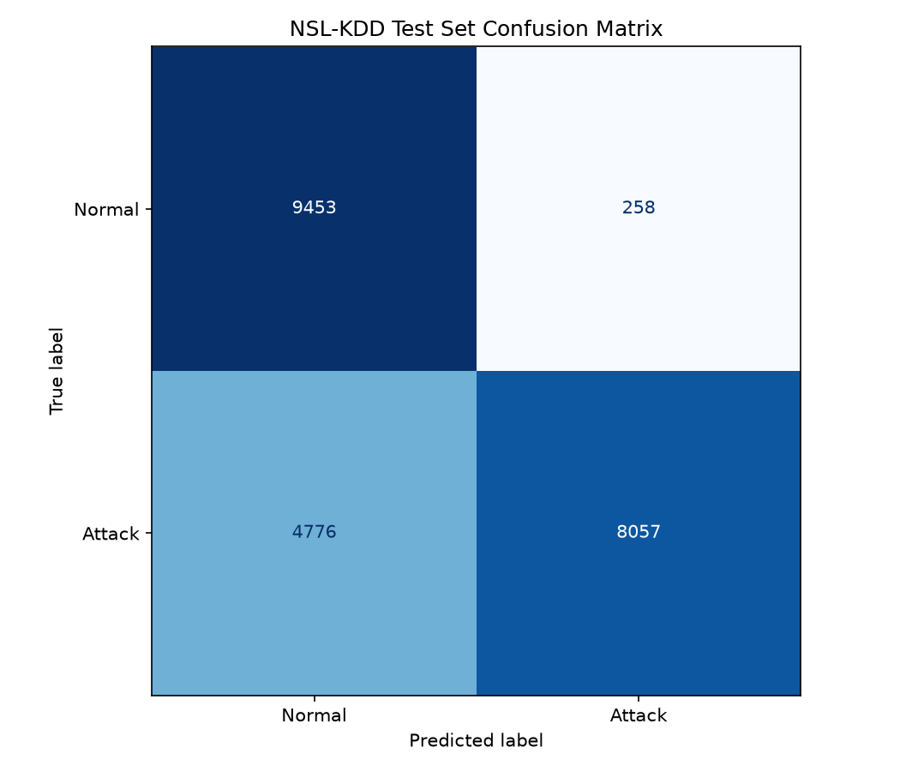
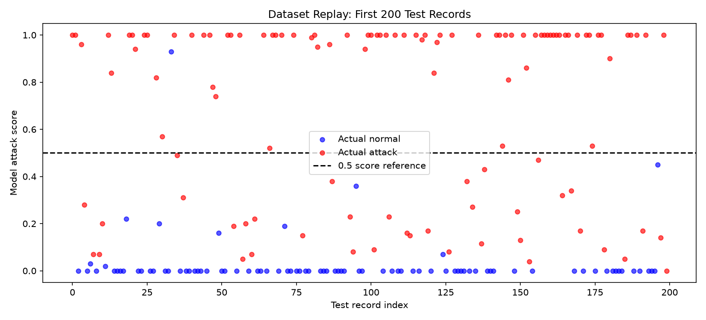

# AI-Powered Cybersecurity Threat Detection

A machine learning project that classifies recorded network traffic as
normal or attack using the NSL-KDD dataset and a Random Forest classifier.

The project includes preprocessing, training, evaluation, a dataset replay
simulation, alert generation, and a local Flask prediction API.

## Problem Statement

Suspicious network activity can be difficult to identify in large volumes
of traffic. This project demonstrates how machine learning can classify
network records and flag potentially malicious activity.

It is a student portfolio prototype using recorded data. It does not
capture live network traffic or automatically prevent attacks.

## Technology Stack

- Python
- Pandas and NumPy
- Scikit-learn
- Random Forest
- Matplotlib
- Flask
- Joblib

Installed package versions are recorded in requirements.txt.

## Architecture

```text
NSL-KDD Training Data
        |
        v
Schema Validation and Label Preparation
        |
        v
Numeric Imputation and Scaling
Categorical Imputation and One-Hot Encoding
        |
        v
Random Forest Training
        |
        v
Saved Preprocessing and Model Pipeline
        |
        +--> Separate Test Set Evaluation
        |
        +--> Dataset Replay and Alert Files
        |
        +--> Flask Prediction API
```

Preprocessing is fitted only on training data. The same saved pipeline
is used during evaluation, simulation, and API predictions.

## Dataset

- Dataset: NSL-KDD
- Training records: 125,973
- Testing records: 22,544
- Input features: 41
- Original files have no header row.
- The remaining two columns contain the attack label and difficulty.
- Normal records are mapped to 0; all attack labels are mapped to 1.
- Attack labels and difficulty are excluded from model inputs.

Official dataset information and publication references:
https://www.unb.ca/cic/datasets/nsl.html

Download mirror used for this project:
https://github.com/Jehuty4949/NSL_KDD

The raw datasets are excluded from Git.

## Project Structure

```text
AI-Cybersecurity-Threat-Detection/
├── data/
│   ├── KDDTrain.txt
│   └── KDDTest.txt
├── docs/
├── images/
│   ├── confusion_matrix.png
│   └── threat_detection_simulation.png
├── models/
│   └── threat_detection_pipeline.joblib
├── notebooks/
├── outputs/
│   ├── metrics.json
│   ├── classification_report.txt
│   ├── test_predictions.csv
│   ├── simulation_predictions.csv
│   └── threat_alerts.csv
├── src/
│   ├── load_data.py
│   ├── preprocess.py
│   ├── train_model.py
│   ├── evaluate_model.py
│   ├── detect_threats.py
│   └── app.py
├── .gitignore
├── main.py
├── README.md
└── requirements.txt
```

Dataset and model files are generated or downloaded locally.
Empty folders may not appear in a Git clone.

## Windows Installation

Open the project folder in VS Code and use its PowerShell terminal.

```powershell
py -m venv .venv
.\.venv\Scripts\python.exe -m pip install -r requirements.txt
New-Item -ItemType Directory -Path data -Force
```

Download the dataset files:

```powershell
Invoke-WebRequest -Uri "https://raw.githubusercontent.com/Jehuty4949/NSL_KDD/master/KDDTrain%2B.txt" -OutFile ".\data\KDDTrain.txt"
Invoke-WebRequest -Uri "https://raw.githubusercontent.com/Jehuty4949/NSL_KDD/master/KDDTest%2B.txt" -OutFile ".\data\KDDTest.txt"
```

## How to Run

Run these commands individually from the project folder.

Inspect the datasets:

```powershell
.\.venv\Scripts\python.exe main.py inspect
```

Train and save the model:

```powershell
.\.venv\Scripts\python.exe main.py train
```

Evaluate on the separate test set:

```powershell
.\.venv\Scripts\python.exe main.py evaluate
```

Replay the first 200 test records and generate alerts:

```powershell
.\.venv\Scripts\python.exe main.py simulate
```

Start the local API:

```powershell
.\.venv\Scripts\python.exe main.py serve
```

The API runs at http://127.0.0.1:5001.
Keep its terminal running. Press Ctrl+C in that terminal to stop it.

## Evaluation Results

Measured on the 22,544-record test set:

| Metric | Result |
| --- | ---: |
| Accuracy | 77.67% |
| Attack precision | 96.90% |
| Attack recall | 62.78% |
| Attack F1 | 76.20% |

| Outcome | Records |
| --- | ---: |
| Normal correctly identified | 9,453 |
| Attacks correctly detected | 8,057 |
| Normal incorrectly flagged | 258 |
| Attacks missed | 4,776 |

The model missed approximately 37.22% of actual attacks.
These results describe this dataset evaluation and do not establish
performance on current production network traffic.

## Visual Results

### Test Set Confusion Matrix



### Dataset Replay



The replay graph covers the first 200 test records only.
It is a demonstration, not the full test-set evaluation.

## API

- GET / returns status and the required feature names.
- POST /predict accepts a JSON object containing a features object.
- The features object must contain all 41 network feature names.
- protocol_type, service, and flag are strings.
- Other feature values must be finite numbers.
- Do not send attack_label, difficulty, or is_attack.

Example response structure:

```json
{
  "Threat_Detected": true,
  "predicted_label": "Attack",
  "attack_score": 1.0,
  "alert": "SUSPICIOUS TRAFFIC",
  "score_note": "Model score, not a verified probability."
}
```

A Neptune-labeled test record returned Attack, and a normal-labeled
test record returned Normal during local API testing. These two examples
supplement the full evaluation; they do not replace it.

## Generated Outputs

- metrics.json: measured evaluation metrics.
- classification_report.txt: per-class evaluation report.
- test_predictions.csv: predictions for the full test set.
- simulation_predictions.csv: predictions for 200 replayed records.
- threat_alerts.csv: replay records predicted as attacks.
- confusion_matrix.png: full test-set confusion matrix.
- threat_detection_simulation.png: replay score visualization.

## Limitations

- This is binary classification, not attack-type identification.
- The replay uses recorded data rather than a live traffic feed.
- The API classifies supplied network features; it does not collect them.
- Alerts are returned through JSON or saved to CSV.
- Model attack scores are not verified probabilities.
- The measured missed-attack rate limits practical use.

## Learning Outcomes

- Loading and validating a cybersecurity dataset.
- Encoding categorical network features.
- Keeping preprocessing consistent between training and prediction.
- Training and saving a Random Forest pipeline.
- Evaluating false alarms and missed attacks.
- Generating alerts from dataset predictions.
- Serving predictions through a local API.